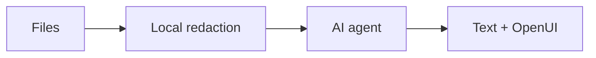

# Chista

A desktop AI debugging app with streamed answers and interactive OpenUI charts, tables, and forms. Works with Codex, Claude Code, or a hosted provider.



## Install

Use an installer matching your operating system and processor. See the [installation guide](docs/INSTALL.md) for installing or building a package.

Install Codex or Claude Code separately, or configure a hosted provider in **Settings → Models**.

## Use

1. Choose a **workspace** and add repo folders in **Workspace config**.
2. Start a **debug session** and chat. Sessions share workspace evidence and keep separate conversations.
3. Attach CSV, TSV, JSON, or logs with **Add files**. Inspect redactions in **Files & mappings**.

Expand any section with its full-screen icon; Escape restores the layout.

Raw imported files and mappings stay local. Review redactions before sharing. Files and chats are cleared when the app restarts.

## Develop

Requires Node.js, Rust, and the [Tauri prerequisites](https://v2.tauri.app/start/prerequisites/).

```sh
npm ci --ignore-scripts
npm run tauri dev
npm test
```
