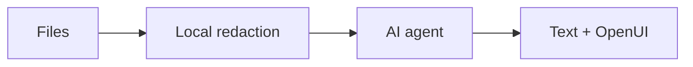

# Chista

Chista is a desktop app for investigating bugs with an AI agent. Bring repository context and debug files into a conversation, then explore streamed explanations alongside interactive OpenUI charts, tables, and forms. Use Codex, Claude Code, or a hosted model provider.



## How it works

A **workspace** groups repository folders, context, and debug files. Each **debug session** has its own conversation within that workspace, so you can investigate different issues using the same evidence.

Imported files are sanitized on your computer with consistent placeholders. **Files & mappings** lets you inspect the sanitized content and see which values were masked. Select the evidence to include, compact it into context, and optionally preview it before sending it to the agent. Raw imported files and the placeholder mapping stay local.

The agent responds with text and can generate interactive UI through OpenUI—for example, an error table, a response chart, or a date picker for a follow-up. CLI agents use their native sign-in. Supported Codex MCP connections can bring external evidence into a session, with approval before each tool runs.

## Install

Use an installer matching your operating system and processor. See the [installation guide](docs/INSTALL.md) for installing or building a package.

Install Codex or Claude Code separately, or configure a hosted provider in **Settings → Models**.

## Use

1. Choose a **workspace** and add repo folders in **Workspace config**.
2. Start a **debug session** and chat. Sessions share workspace evidence and keep separate conversations.
3. Attach CSV, TSV, JSON, or logs with **Add files**. Inspect redactions in **Files & mappings**.

Expand any section with its full-screen icon; Escape restores the layout.

Files and chats are currently cleared when the app restarts. See the [installation guide](docs/INSTALL.md) for platform support and current integration limits.

## Develop

Requires Node.js, Rust, and the [Tauri prerequisites](https://v2.tauri.app/start/prerequisites/).

```sh
npm ci --ignore-scripts
npm run tauri dev
npm test
```
