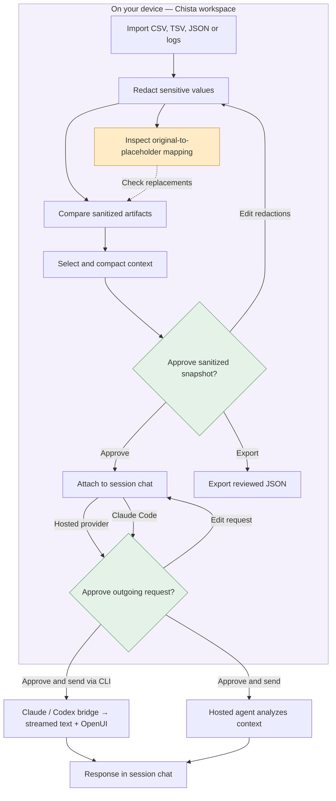

# Chista

**Chat about a bug. Get an answer—and an interactive view when it helps.**

Chista is a desktop chat workspace for debugging with an AI agent. Type in the composer at the bottom; answers appear above it as text and, when useful, generated OpenUI charts, tables and follow-up controls. Create a workspace with repos, debug files and sanitized context, then run separate debug sessions on that workspace.

The sidebar switches workspaces and lists debug sessions for the selected workspace. New sessions reuse workspace repos, files, mappings and selected context; conversations and drafts remain separate. Closing a session keeps workspace evidence. The first structured agent response supplies a short session name. Use the pencil beside a session (or double-click its name) to rename it; Enter or moving focus saves, and Escape cancels. Manual names are never replaced by agent suggestions. Plain-text replies keep the placeholder name until you rename it. Settings sits at the bottom of the sidebar. Select a session or the Chista name to return to chat. Session tools are in the menu beside the session title. **Add files** opens the file picker and attaches locally sanitized files directly in the composer. Click an attachment to preview its sanitized content or remove it with ×. You stay in chat; mappings and advanced redaction controls are optional. Send waits for sanitization and includes only compacted sanitized content, never original filenames or mappings. Repo selection and file review open only when you need them; they are not steps you must complete before chatting.

Redaction happens locally. AI analysis runs through your configured hosted provider or Claude Code. Chista does not run or download a local model.

> Live agent connections require the Tauri desktop app and your configured Claude Code CLI, Codex CLI or hosted provider. Browser mode supports local file review only. No sample incidents, scripted answers or demo provider are included. See [validation and current blockers](#validation-and-current-blockers).

## How it works



**The mapping stays on your device.** An agent sees placeholders such as `[EMAIL_1]`, not the original values behind them. The same value gets the same placeholder across a workspace's artifacts, so the agent can follow relationships between files.

For example:

| Original file, visible locally | Sanitized context for the agent |
| --- | --- |
| `ERROR email=alex@example.com ip=10.0.1.24` | `ERROR email=[EMAIL_1] ip=[IP_1]` |

The Mappings tab lets you look up those placeholders, see where they appear and hide originals on screen. Neither the mapping nor original filenames are included in context exports, hosted requests or the Claude copy action.

Pattern detection can miss sensitive information. Review the output and add custom redactions before approving a handoff. Native agent chat runs with tools disabled; Chista sends only sanitized context and never exposes raw imported files.

## What you can do

- **Investigate across files:** import logs, CSV or TSV request data and JSON configuration into one workspace, with consistent masking across artifacts.
- **Understand every replacement:** review sanitized previews and search a local mapping of originals, placeholders, occurrence counts and source files.
- **Explore the evidence:** compare artifacts and use OpenUI charts, searchable tables and follow-up controls. These views use local heuristics, not AI diagnoses.
- **Give the agent focused context:** select artifacts, remove duplicate lines, set a content budget and review the exact payload before sharing.
- **Keep investigations separate:** switch between workspaces without mixing evidence; run multiple debug sessions against shared workspace context with separate chat histories.
- **Control tool access:** connect MCP servers and approve each tool invocation with its exact arguments. Tool results are not forwarded to a model automatically.

## Run

```sh
npm install --ignore-scripts
npm run dev             # browser preview; live integrations require desktop
npm test
npm run build           # TypeScript + production frontend
npm run tauri dev       # native desktop; requires Rust and Tauri platform prerequisites
npm run tauri build
```

Install the [Tauri prerequisites](https://v2.tauri.app/start/prerequisites/) separately. No local model, Ollama, model download or inference server is used.

## Connect your agent

Open the desktop app. Codex is selected by default. In **Settings → Models**, check its installation or provide the executable path. Complete sign-in in Claude’s native terminal flow. Alternatively configure a hosted provider. Claude’s check reports installation and native sign-in status; the first approved request verifies model access. Codex installation detection alone does not verify authentication.

Start with your own question or import debug files. There are no preloaded incidents or simulated answers. Connection failures stay visible and never switch to a scripted provider.

## Everyday flow

1. **Start a session.** The conversation opens immediately with a text box at the bottom.
2. **Chat.** Press Enter or Send; use Shift+Enter for a new line. Review and approve the outgoing message to send it to the selected Claude Code, Codex or hosted provider.
3. **Add context when needed.** Use **Repos** to include one or more registered checkouts. Use **Files & mappings** or **Add files** to import, mask and review debug data.
4. **Explore the response.** The agent can combine text with OpenUI charts, searchable tables and follow-up buttons. A follow-up fills the composer so you can edit it before sending.

Repositories form a shared catalog; each workspace chooses its repos. Debug sessions belong to a workspace and use its current sanitized context. Including a repo does not read or upload its files. Native agent chat runs in an isolated temporary directory.

| Control | Purpose |
| --- | --- |
| **New session / recent sessions** | Start or return to a separate conversation using workspace files and context. |
| **Repos → Manage repos** | Register existing checkouts and choose which ones a workspace includes. |
| **Files & mappings** | Import, mask and inspect artifacts before handing sanitized context to the agent. |
| **Top-right Settings → Models** | Choose Claude Code, Codex or a hosted chat provider. |
| **Settings → MCP** | Configure servers and discover tools; tool controls stay hidden in chat until a server is connected. |
| **Settings → General** | Review data handling and clear saved repository metadata. |

Only workspace names, repo membership, repository names and directory paths survive app restarts. Previously saved project entries migrate into the repo catalog. Sessions, artifacts, mappings, chat and integration credentials remain in memory.

## Generated response UI

Hosted agents receive a response contract for text plus optional chart, table, text-input, date-picker, date-range, form, code, JSON and follow-up blocks. Chista validates those blocks and renders them through an allowlisted OpenUI component library. It does not execute model-provided JavaScript, HTML, network requests or tool calls. Invalid structured replies fall back to escaped text.

Charts support selecting categories, tables support searching, and follow-ups populate the composer. Agents can generate a text box using an input block; its button prepares a follow-up in the composer without sending automatically. Date-picker blocks offer a native calendar with optional minimum and maximum dates; their button adds the selected date and label to the composer without sending. Date ranges validate start/end order. Forms support up to ten text, number, dropdown, multiselect, radio, checkbox, date or time fields with required-field and numeric-bound validation. A single-field form provides a standalone control. Copyable code and formatted JSON viewers display content as text and never execute it. Typed input follows the same local sanitization and optional outgoing review as any chat message. Plain-text responses work too. Charts and tables use the agent’s structured reply; local evidence views use only your imported sanitized artifacts.

## Safe Debug Sessions

1. Import header-based CSV or TSV, JSON, LOG or TXT; up to 20 artifacts, 2 MB each.
2. Preview local redactions, optionally reveal originals locally, and add exact custom sensitive values. Consistent placeholders preserve relationships across artifacts. The **Mappings** tab shows original → placeholder pairs, occurrence counts and source artifacts. Search the mapping or hide originals on screen. The mapping stays in the workspace on this device and is never included in model requests, context exports or the Claude copy action.
3. Compare sanitized artifacts by line position. OpenUI renders interactive severity charts, searchable evidence tables and follow-up controls (500 analyzed lines, 100 displayed matching rows).
4. Select artifacts, compact them, and review the exact JSON snapshot. Duplicate lines are removed; the content budget truncates excerpts and reports omitted characters.
5. Explicitly acknowledge review before exporting or attaching the snapshot to this workspace's debug sessions. Attaching opens Agent chat, where the sanitized data can be sent to the configured hosted provider with optional outgoing-request review. Artifact/selection/redaction changes revoke the attachment. Raw files and filenames never enter the provider interface.

Sanitization detects common secret/PII patterns and sensitive structured fields. It cannot guarantee detection of every secret; inspect the preview and add custom redactions. Chat uses a separate `CHAT_` placeholder namespace to avoid falsely associating a newly typed identity with an artifact placeholder.

## Choose an agent

| Option | How context reaches it | Setup |
| --- | --- | --- |
| **Codex** | Review sanitized context and receive text plus OpenUI results in chat. | Installed Codex CLI with native sign-in. |
| **Claude Code** | Review and send sanitized context; receive streamed prose and OpenUI results in chat. | Use your installed CLI; sign in through Claude’s own terminal flow. |
| **Hosted provider** | Approve the exact outgoing request in session chat. | Configure an HTTPS chat-completions endpoint, model and optional API token. |

The app starts with Claude Code selected. Selecting an integration does not send data or prove that it is connected.

### Switch agents

The composer’s **Review before sending** checkbox is enabled by default per session. Uncheck it to send directly with the same local sanitization and native sign-in flow. Recheck it to preview each outgoing message. Chat attachments use this same review preference. Explicit artifact exports still require review, and MCP tools still require per-tool approval.

Use **Chat agent** beside the composer to switch between Claude Code and Codex without leaving your session. **Settings → Models → Active agent** controls the same selection and also offers a configured hosted provider. Switching cancels any active CLI request and revokes pending approval. Your conversation stays in the session; the next preview includes the sanitized history and explicitly names its new destination.

### Codex

Select **Codex** and check installation in Settings → Models. Detection checks PATH, common CLI locations and macOS VS Code extension binaries; an absolute executable override is also available. When you send a message, Chista checks `codex login status`. If needed, it opens `codex login` in Terminal and waits for sign-in before sending the approved message automatically. Chista never collects Codex credentials.

Each Chista session starts one dedicated `codex app-server --stdio` in an empty temporary directory and reuses native authentication. Chista keeps its ephemeral thread alive across successful turns, forwards `item/agentMessage/delta` notifications immediately and reconciles the final message on completion. It never attaches to a shared daemon or an external thread. The OpenAI cloud provider is selected; the CLI’s configured model is retained.

App-server does not support exec’s `--ignore-user-config`. Instead, Chista explicitly overrides custom instructions and disables shell/image/browser/computer tools, hooks, plugins, apps, MCP server configuration, project instructions and memory injection. The restricted filesystem profile prevents repository access and command network traffic. Chista reads effective configuration before creating the thread and explicitly disables each inherited MCP server; empty configuration alone does not remove inherited entries. Configuration values and credentials are never forwarded to the model. Incoming tool/approval requests are rejected. Only approved sanitized strings go over stdin. MCP calls remain separately approved in Chista. A recent CLI supporting these settings is required; unsupported configurations fail without weaker retries.

References: [official app-server documentation](https://developers.openai.com/codex/app-server), [configuration reference](https://developers.openai.com/codex/config-reference).

### Claude Code

1. Run the Tauri desktop app and select **Settings → Models → Claude Code**. Check installation or enter an absolute executable path.
2. When sending a message, Chista checks sign-in and opens `claude auth login` in Terminal if needed. Complete Claude’s own flow; the approved message then continues automatically. No repository is required. Manual sign-in is also available in Settings. Chista never asks for Claude credentials.
3. Type a message and send it. If **Review before sending** is checked, preview and approve the sanitized payload first. Text streams above the composer; validated structured responses render as interactive OpenUI charts, tables and follow-up controls. Plain-text answers also work.
4. **Stop**, switching sessions or closing chat cancels the request. Failed requests are not automatically retried or replaced with scripted results.

The bridge keeps a `claude -p --input-format stream-json --output-format stream-json` process alive for each Chista session through a narrow Tauri command. The payload goes over stdin, not shell arguments. Each session uses an empty temporary working directory, safe mode, no built-in or MCP tools, disabled hooks, and no on-disk CLI session persistence. Conversation memory stays in that process; Chista never resumes an unrelated CLI session. Repository files and local redaction mappings are not part of the request. This is evidence-only debugging; autonomous repository edits are not enabled. MCP tools remain separately approved in Chista.

A recent Claude Code CLI supporting `--safe-mode` is required. Unsupported flags or missing authentication produce an error; Chista never retries with weaker restrictions. Existing CLI authentication and provider configuration determine the cloud destination. Managed enterprise policies still apply. See the [official CLI reference](https://code.claude.com/docs/en/cli-reference).

The chat has no terminal setup section. Native login opens on macOS and Linux; Windows users receive the command to run in their own terminal. Chista waits up to five minutes for sign-in. Stop, switching agents/sessions, or leaving chat cancels the pending send and preserves the draft. Browser mode supports local file review; agent chat requires desktop.

### Persistent CLI sessions

Claude and Codex receive the system/OpenUI instructions once when Chista creates their connection. The first turn includes sanitized context and any existing chat history; subsequent turns send only the new sanitized message. Review previews show the actual new payload and explain when prior conversation is retained. Visiting another idle Chista session preserves its connection.

Changing the agent, executable path, attached context, or sanitized history resets the connection. The next user-initiated send initializes a fresh process with the current sanitized conversation. A failed, cancelled or interrupted turn also discards the connection; model calls are never automatically retried. Closing a session, reloading the app, or closing the desktop window reaps the subprocesses. Up to eight independent CLI connections and four active turns are allowed. Threads and conversations are not restored after restarting Chista.

This reduces repeated initialization and data sent from Chista to the CLI. The CLI/cloud provider still controls model context transmission and token accounting; it does not guarantee reduced token charges. Generic hosted chat-completions endpoints remain stateless and receive the full instructions and history each turn.

### Hosted model providers

`src/integrations/providers.ts` defines `ModelProvider`, `ModelRequest` and the provider implementations. The optional hosted adapter accepts an HTTPS chat-completions endpoint, a model identifier and optional API bearer token. It sends `{ model, stream: false, messages }` and expects `choices[0].message.content`. This is a compatible-endpoint adapter, not a universal adapter for every vendor API. Add another implementation of `ModelProvider` for a different protocol.

For hosted providers, the exact JSON body, including instructions, sanitized history, reviewed context and `stream: true`, is previewed before each send. SSE text chunks render immediately. Endpoints that ignore streaming and return JSON remain compatible but can only display completed text. Structured UI follows the response contract in `src/AgentResponse.tsx`. No tool execution is delegated to model responses. Tokens/configuration remain in memory. Requests have cancellation and a 125-second UI timeout (the Claude subprocess has a 120-second limit). Status distinguishes configured, connecting, last-successful and failed states. There are no background model calls. Browser preview blocks live network integrations and supports local file review only.

## MCP tools

MCP connects a session to tools exposed by a configured server. Server setup lives in Settings; tool use lives alongside the session’s agent chat. Each invocation is a separate action that you review and approve.

Uses the official `@modelcontextprotocol/sdk` v1 client and Streamable HTTP transport through Tauri's native HTTP bridge. The SDK handles initialization/version negotiation, initialized notification, session headers, JSON/SSE responses and JSON-RPC calls. Tool discovery is paginated and bounded. Supports HTTPS and loopback HTTP; redirects are disabled. Optional bearer tokens are memory-only. This MVP does not support stdio transport, OAuth authorization flows, resources/prompts UI, automatic tool chaining, or auto-reconnecting after a failed connection.

Create a server in Settings → MCP, then explicitly connect to discover its tools. Within the selected session's Agent chat, expand MCP tools, choose a tool and enter JSON arguments. Chista sanitizes the arguments and previews destination, tool, arguments and session. **Approve once** is bound to that exact call; altered arguments, a different session, denial, disconnect and repeated calls cannot reuse approval. Remote tools may have side effects. Input schemas are displayed; final argument validation is performed by the MCP server. No artifact is attached automatically. Tool results are displayed locally and never added to a model conversation automatically.

MCP configurations and tokens currently last for this app run. Disconnect before changing a token; remove and re-add to change an endpoint. Connection status is updated for connecting, success, transport errors and disconnect. Implementation references: [MCP TypeScript SDK](https://github.com/modelcontextprotocol/typescript-sdk), [Tauri HTTP bridge](https://v2.tauri.app/plugin/http-client/).

## Data boundaries

Raw files, original filenames, placeholder mappings, custom terms, chat history and reviewed snapshots live in memory. Only repository metadata goes into localStorage. Native code exposes narrow Claude detection, launch, chat and cancellation commands, plus scoped HTTP access; no general filesystem or shell plugin is enabled. The provider receives only the approved snapshot and sanitized chat strings. The application does not log payloads or credentials. Releasing references is not a secure memory-erasure guarantee.

## Validation and current blockers

The frontend tests cover the sanitizer, session isolation, repository membership, exact request previews, OpenUI replies, MCP approvals and the Claude bridge’s streaming, cancellation race, failure and browser-mode behavior. `npm run build` verifies TypeScript and bundles the frontend.

Rust/Cargo was found at `~/.cargo/bin`. The Tauri desktop build and Rust tests pass, including real fixture subprocesses for streaming, cancellation and errors. The tests do not contact a cloud model; persistent subprocess fixtures verify two-turn reuse, isolation, cancellation, and cleanup. A missing desktop icon was added so Tauri can compile.

The installed Codex CLI was verified against a localhost mock Responses endpoint with a synthetic prompt; no debug data was sent to an AI service. Two text deltas arrived before turn completion. A further two-turn localhost probe confirmed that one Codex thread retained the previous user message and assistant answer. No file, shell or MCP tools were exposed after explicitly disabling inherited MCP servers for the ephemeral thread. The installed Claude CLI also completed two turns against a localhost mock Anthropic endpoint with dummy credentials, retaining prior user/assistant messages and exposing no tools. Live cloud authentication and generation are not verified.

Claude Code 2.1.309 is installed at `/opt/homebrew/bin/claude`. Its native authentication check reports not signed in; model access remains blocked until you complete Claude’s login flow. Chista checks this before starting inference and reports sign-in, rate-limit, billing and network errors without echoing provider diagnostics. Live hosted-provider and MCP credentials were not provided; those transports are tested with mocks. Local file review needs no credentials. Test fixtures are not bundled into the application.

### Streaming behavior

Text is displayed as it arrives, with a streaming indicator and Stop control. JSON response instructions request the prose first. Charts, tables and follow-up controls appear only after the completed response validates. No artificial typing animation or delayed replay is used. Tests cover partial output before completion, split UTF-8 and SSE frames, cancellation, and truncated streams.
