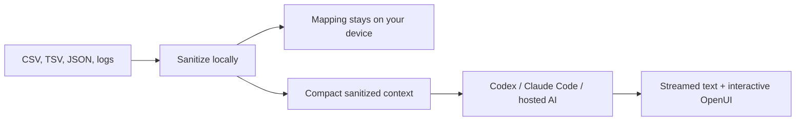

# Chista

A desktop debugging workspace powered by Codex, Claude Code, or a hosted AI provider. Chat about an issue and get streamed answers with interactive OpenUI charts, tables, and forms when useful.

Built with Tauri 2, React, TypeScript, and OpenUI.

## How it works

A **workspace** holds your repos, debug files, redaction mappings, and sanitized context. Run multiple **debug sessions** on that workspace, each with its own conversation.



Raw imported files, original filenames, and redaction mappings are excluded from AI requests. Consistent placeholders preserve relationships between files. Redaction is pattern based, so inspect sensitive data before sharing.

## Get started

Install Node.js, Rust, and the [Tauri platform prerequisites](https://v2.tauri.app/start/prerequisites/). For CLI chat, install Codex or Claude Code separately.

```sh
npm ci --ignore-scripts
npm run tauri dev
```

1. Choose a workspace from the dropdown in the sidebar. Create one or open **Workspace config** from the same menu. Add repos by selecting their folders.
2. Start a **New session** and chat. Codex is the default; switch agents beside the composer or in **Settings → Models**. CLI sign-in opens when needed.
3. Use **Add files** in the composer to attach debug data. **Files & mappings** opens redaction previews, local mappings, artifact comparison, and context controls.

**Review before sending** is optional. Local sanitization always runs. A hosted provider can be configured in Settings using an HTTPS chat-completions endpoint, model name, and API token.

## MCP tools

Codex chat uses HTTP MCP servers already configured in Codex CLI. Ask to connect to a server by name. Every tool call requires approval, and tool results are sanitized locally before reaching the model. If authentication is required, chat offers the native Codex MCP sign-in flow.

HTTPS and loopback HTTP endpoints are supported. Local servers must be running. Stdio servers, Claude MCP, and hosted-provider MCP are not supported yet.

## Current limits

- Workspace names and repo membership persist. Files, mappings, context, chats, and app-entered API tokens remain in memory and are cleared when Chista restarts.
- Adding a repo registers its location; Chista does not automatically read or upload its files. Built-in shell and filesystem tools are disabled in agent chat.
- Imports support CSV, TSV, JSON, LOG, and TXT, with up to 20 files per workspace and 2 MB per file.
- Live agent connections and folder selection require the desktop app. Browser preview supports local file review.

## Development

```sh
npm run dev             # Browser preview
npm test                # Frontend tests
npm run build           # TypeScript + production frontend
cargo test --manifest-path src-tauri/Cargo.toml
npm run tauri build     # Desktop build
```
