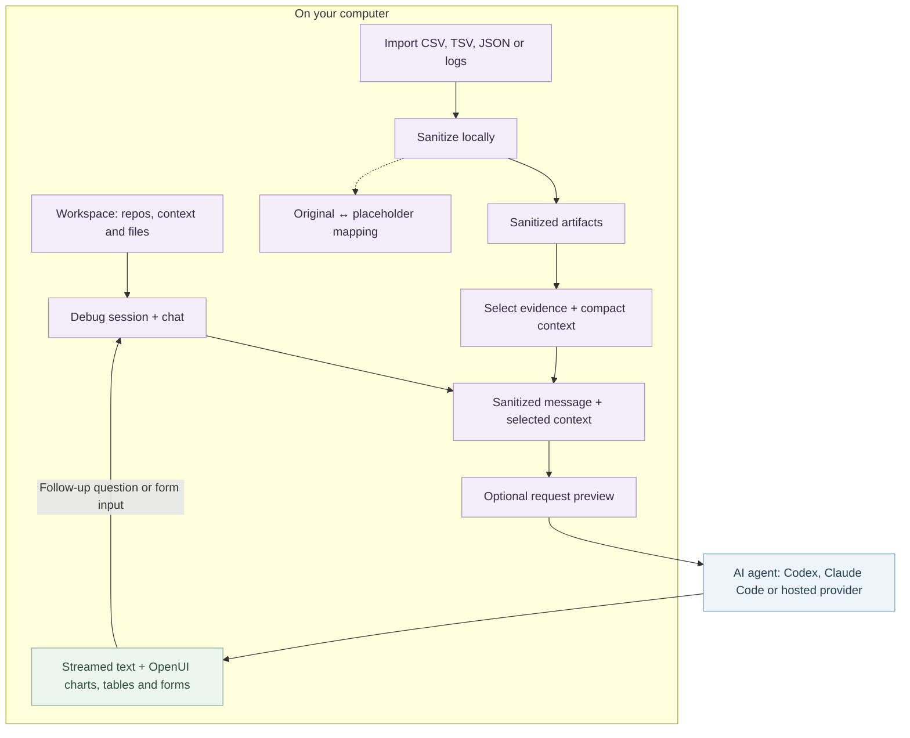

# Chista

Chista is a desktop app for investigating bugs with an AI agent. Bring repository context and debug files into a conversation, then explore streamed explanations alongside interactive OpenUI charts, tables, and forms. Use Codex, Claude Code, or a hosted model provider.

## How it works

A **workspace** groups repository folders, context, and debug files. Run separate **debug sessions** in the same workspace to investigate different issues with independent conversations.



1. **Bring the evidence.** Add repo folders in **Workspace config**, start a session, and attach debug files directly in chat. Adding a repository does not upload its contents to the agent.
2. **Inspect the masking.** Local sanitization replaces detected sensitive values with consistent placeholders, so repeated values remain traceable across artifacts. **Files & mappings** shows the sanitized content and its original-to-placeholder mapping. Inspect these before sharing; pattern matching can miss sensitive values.
3. **Choose what to send.** Select and compact the relevant sanitized evidence into context. The small **Review before sending** checkbox lets you preview the outgoing request. Raw imported files and mappings stay on your computer; the agent receives the prepared conversation and selected sanitized context.
4. **Investigate together.** Answers stream into chat and can include OpenUI charts, tables, and forms. Controls such as date pickers prepare a follow-up in the message box; you choose when to send it.

CLI agents use their native sign-in. Supported **Codex MCP** connections can retrieve external evidence: each tool call needs approval, and its result is sanitized before returning to the agent. Tool approval remains required even when request preview is off. See the [installation guide](docs/INSTALL.md) for supported connections and current limits.

## Install

Use an installer matching your operating system and processor. See the [installation guide](docs/INSTALL.md) for installing or building a package.

Install Codex or Claude Code separately, or configure a hosted provider in **Settings → Models**.

To build an installer from source after installing the [platform prerequisites](docs/INSTALL.md#prerequisites) and running `npm ci --ignore-scripts`:

| Build computer | Command                                 | Installer directory                     |
| -------------- | --------------------------------------- | --------------------------------------- |
| Mac            | `npm run tauri build -- --bundles dmg`  | `src-tauri/target/release/bundle/dmg/`  |
| Windows        | `npm run tauri build -- --bundles nsis` | `src-tauri/target/release/bundle/nsis/` |

The documented verified build is macOS on Apple Silicon. See the guide for [processor options](docs/INSTALL.md#macos-disk-image-dmg), signing requirements, and [troubleshooting](docs/INSTALL.md#troubleshooting).

## Use

1. Choose a **workspace** and add repo folders in **Workspace config**.
2. Start a **debug session** and chat. Sessions share workspace evidence and keep separate conversations.
3. Attach CSV, TSV, JSON, or logs with **Add files**. Inspect redactions in **Files & mappings**.

Tool activity shows what actually ran; response sources open the sanitized evidence. Completed OpenUI blocks can appear while an answer streams. Follow the [access-investigation guide](docs/INVESTIGATION.md) for a repeatable test incident or your own data.

Expand any section with its full-screen icon; Escape restores the layout.

Files, chats, and hosted provider settings are cleared when the app restarts. Workspace definitions and repository metadata are saved on this device. See [data storage](docs/INSTALL.md#data-stored-on-this-computer) for details.

## Develop

See the [development guide](docs/DEVELOPMENT.md) for the source layout, data boundaries, formatting, and checks.

Requires Node.js, Rust, and the [Tauri prerequisites](https://v2.tauri.app/start/prerequisites/).

```sh
npm ci --ignore-scripts
npm run tauri dev
```

The desktop command starts Vite and opens Chista. For a browser preview with local file review, use `npm run dev` and open `http://127.0.0.1:1420`. Repository folder selection and CLI integrations require the desktop app.

Run the application checks from the repository root:

```sh
npm test
npm run format:check
npm run build
cargo test --manifest-path src-tauri/Cargo.toml
```

`npm run build` checks TypeScript and builds the frontend. Use the Tauri build commands above to create installers. The [access-investigation guide](docs/INVESTIGATION.md#checks) documents the MCP connector smoke check; [video/README.md](video/README.md) covers the Remotion demo.
