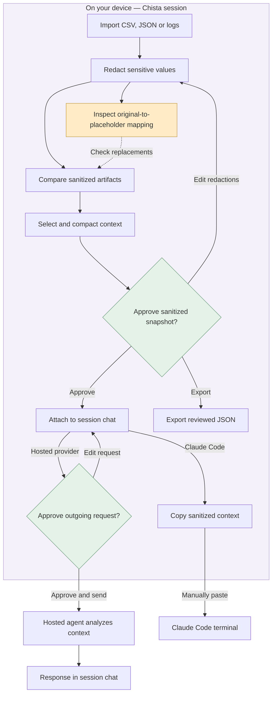

# Chista

**Chat about a bug. Get an answer—and an interactive view when it helps.**

Chista is a desktop chat workspace for debugging with an AI agent. Type in the composer at the bottom; answers appear above it as text and, when useful, generated OpenUI charts, tables and follow-up controls. Start a session and optionally include multiple repos or sanitized debug files.

The sidebar contains recent sessions. Settings lives in the top right. Repo selection and file review open only when you need them; they are not steps you must complete before chatting.

Redaction happens locally. AI analysis runs through your configured hosted provider or Claude Code. Chista does not run or download a local model.

> **MVP status:** Safe Debug Sessions and the browser demo work without an agent connection. Live integrations require the Tauri desktop app. Native builds and real-service integration checks remain unverified in the development environment; see [validation and current blockers](#validation-and-current-blockers).

## How it works



**The mapping stays on your device.** An agent sees placeholders such as `[EMAIL_1]`, not the original values behind them. The same value gets the same placeholder across a session's artifacts, so the agent can follow relationships between files.

For example:

| Original file, visible locally | Sanitized context for the agent |
| --- | --- |
| `ERROR email=alex@example.com ip=10.0.1.24` | `ERROR email=[EMAIL_1] ip=[IP_1]` |

The Mappings tab lets you look up those placeholders, see where they appear and hide originals on screen. Neither the mapping nor original filenames are included in context exports, hosted requests or the Claude copy action.

Pattern detection can miss sensitive information. Review the output and add custom redactions before approving a handoff. Claude Code runs independently and can access files already in its selected repository under its native permissions; Chista does not send it imported files automatically.

## What you can do

- **Investigate across files:** import logs, CSV request data and JSON configuration into one session, with consistent masking across artifacts.
- **Understand every replacement:** review sanitized previews and search a local mapping of originals, placeholders, occurrence counts and source files.
- **Explore the evidence:** compare artifacts and use OpenUI charts, searchable tables and follow-up controls. These views use local heuristics, not AI diagnoses.
- **Give the agent focused context:** select artifacts, remove duplicate lines, set a content budget and review the exact payload before sharing.
- **Keep investigations separate:** switch between sessions and their included repos without mixing their artifacts, mappings or chat histories.
- **Control tool access:** connect MCP servers and approve each tool invocation with its exact arguments. Tool results are not forwarded to a model automatically.

## Run

```sh
npm install --ignore-scripts
npm run dev             # browser preview; live integrations require desktop
npm test
npm run build           # TypeScript + production frontend
npm run tauri dev       # native desktop; requires Rust and Tauri platform prerequisites
npm run tauri build
```

Install the [Tauri prerequisites](https://v2.tauri.app/start/prerequisites/) separately. No local model, Ollama, model download or inference server is used.

## Everyday flow

1. **Start a session.** The conversation opens immediately with a text box at the bottom.
2. **Chat.** Press Enter or Send; use Shift+Enter for a new line. Demo responses are explicitly labeled. Choose a hosted provider in the top-right Settings for real AI answers.
3. **Add context when needed.** Use **Repos** to include one or more registered checkouts. Use **Files & mappings** or **Add files** to import, mask and review debug data.
4. **Explore the response.** The agent can combine text with OpenUI charts, searchable tables and follow-up buttons. A follow-up fills the composer so you can edit it before sending.

Repositories form a shared catalog; sessions are independent investigations. One repo can be included in several sessions. Including a repo does not read or upload its files. Claude Code launches in one included repo at a time.

| Control | Purpose |
| --- | --- |
| **New session / recent sessions** | Start or return to a conversation with isolated artifacts, mappings and history. |
| **Repos → Manage repos** | Register existing checkouts and choose which ones a session includes. |
| **Files & mappings** | Import, mask and inspect artifacts before handing sanitized context to the agent. |
| **Top-right Settings → Models** | Choose a hosted chat provider, demo mode or the external Claude Code terminal integration. |
| **Settings → MCP** | Configure servers and discover tools; tool controls stay hidden in chat until a server is connected. |
| **Settings → General** | Review data handling and clear saved repository metadata. |

Only repository names and directory paths survive app restarts. Previously saved project entries migrate into the repo catalog. Sessions, artifacts, mappings, chat and integration credentials remain in memory.

## Generated response UI

Hosted agents receive a response contract for text plus optional chart, table and follow-up blocks. Chista validates those blocks and renders them through an allowlisted OpenUI component library. It does not execute model-provided JavaScript, HTML, network requests or tool calls. Invalid structured replies fall back to escaped text.

Charts support selecting categories, tables support searching, and follow-ups populate the composer. Plain-text responses work too. Demo mode builds example widgets from the attached sanitized context; it does not pretend to be a connected model. To try it, open **Files & mappings**, load the sample session, prepare and attach reviewed context, then ask “Show patterns.”

## Safe Debug Sessions

1. Import header-based CSV, JSON, LOG or TXT; up to 20 artifacts, 2 MB each. Fictional sample data is available.
2. Preview local redactions, optionally reveal originals locally, and add exact custom sensitive values. Consistent placeholders preserve relationships across artifacts. The **Mappings** tab shows original → placeholder pairs, occurrence counts and source artifacts. Search the mapping or hide originals on screen. The mapping stays in the session on this device and is never included in model requests, context exports or the Claude copy action.
3. Compare sanitized artifacts by line position. OpenUI renders interactive severity charts, searchable evidence tables and follow-up controls (500 analyzed lines, 100 displayed matching rows).
4. Select artifacts, compact them, and review the exact JSON snapshot. Duplicate lines are removed; the content budget truncates excerpts and reports omitted characters.
5. Explicitly acknowledge review before exporting or attaching the snapshot to this session's chat. Attaching opens Agent chat, where the sanitized data can be sent to the configured hosted provider after outgoing-request review. Artifact/selection/redaction changes revoke the attachment. Raw files and filenames never enter the provider interface.

Sanitization detects common secret/PII patterns and sensitive structured fields. It cannot guarantee detection of every secret; inspect the preview and add custom redactions. Chat uses a separate `CHAT_` placeholder namespace to avoid falsely associating a newly typed identity with an artifact placeholder.

## Choose an agent

| Option | How context reaches it | Setup |
| --- | --- | --- |
| **Claude Code** | Copy the reviewed sanitized context and paste it into the native terminal. | Use your installed CLI; sign in through Claude’s own flow. |
| **Hosted provider** | Approve the exact outgoing request in session chat. | Configure an HTTPS chat-completions endpoint, model and optional API token. |
| **Demo assistant** | Nothing leaves the device; responses are scripted workflow suggestions. | No connection required. |

The app starts in demo mode. Selecting an integration does not send data or prove that it is connected.

### Claude Code

1. Register repository directories in Repos, create a session, and select the repos to include.
2. In the top-right Settings → Models, choose **Claude Code**. Check installation; optionally enter an absolute executable path. Detection checks PATH and common installation locations, including `~/.local/bin/claude`.
3. In the session chat, select a **Launch repository** from its included repos and choose **Launch Claude Code**. On macOS it opens Terminal via AppleScript; on Linux it uses `x-terminal-emulator`. Windows launch is not implemented.

The launcher starts the installed `claude` executable in the repository directory, without a prompt or credentials. Claude handles its own native sign-in, trust and tool approval flow. Chista never runs an invented login command, collects Claude credentials, injects imported debug files, or captures terminal output. Launch success means Terminal opened, not that the CLI is authenticated.

Claude runs independently and can read files already in its repository directory under its native permissions. Keep raw debug files outside that directory. Chista does not copy imported artifacts into repositories. Reviewed context can be copied with **Copy sanitized context for Claude** and pasted into its terminal; the mapping and originals are excluded. It is not automatically passed to Claude. See the [Claude Code quickstart](https://code.claude.com/docs/en/quickstart).

### Hosted model providers

`src/integrations/providers.ts` defines `ModelProvider`, `ModelRequest` and the provider implementations. The optional hosted adapter accepts an HTTPS chat-completions endpoint, a model identifier and optional API bearer token. It sends `{ model, stream: false, messages }` and expects `choices[0].message.content`. This is a compatible-endpoint adapter, not a universal adapter for every vendor API. Add another implementation of `ModelProvider` for a different protocol.

For hosted providers, the exact JSON body, including instructions, sanitized history and reviewed context, is previewed before each send. Demo messages run immediately without a network request. Structured UI follows the response contract in `src/AgentResponse.tsx`. No tool execution is delegated to model responses. Tokens/configuration remain in memory. Requests have cancellation and a 60-second timeout. Status distinguishes configured, connecting, last-successful and failed states. There are no background model calls. Browser preview blocks live network integrations and supports the labeled demo assistant.

## MCP tools

MCP connects a session to tools exposed by a configured server. Server setup lives in Settings; tool use lives alongside the session’s agent chat. Each invocation is a separate action that you review and approve.

Uses the official `@modelcontextprotocol/sdk` v1 client and Streamable HTTP transport through Tauri's native HTTP bridge. The SDK handles initialization/version negotiation, initialized notification, session headers, JSON/SSE responses and JSON-RPC calls. Tool discovery is paginated and bounded. Supports HTTPS and loopback HTTP; redirects are disabled. Optional bearer tokens are memory-only. This MVP does not support stdio transport, OAuth authorization flows, resources/prompts UI, automatic tool chaining, or auto-reconnecting after a failed connection.

Create a server in Settings → MCP, then explicitly connect to discover its tools. Within the selected session's Agent chat, expand MCP tools, choose a tool and enter JSON arguments. Chista sanitizes the arguments and previews destination, tool, arguments and session. **Approve once** is bound to that exact call; altered arguments, a different session, denial, disconnect and repeated calls cannot reuse approval. Remote tools may have side effects. Input schemas are displayed; final argument validation is performed by the MCP server. No artifact is attached automatically. Tool results are displayed locally and never added to a model conversation automatically.

MCP configurations and tokens currently last for this app run. Disconnect before changing a token; remove and re-add to change an endpoint. Connection status is updated for connecting, success, transport errors and disconnect. Implementation references: [MCP TypeScript SDK](https://github.com/modelcontextprotocol/typescript-sdk), [Tauri HTTP bridge](https://v2.tauri.app/plugin/http-client/).

## Data boundaries

Raw files, original filenames, placeholder mappings, custom terms, chat history and reviewed snapshots live in memory. Only repository metadata goes into localStorage. Native code exposes narrow Claude detection/launch commands, plus scoped HTTP access; no general filesystem or shell plugin is enabled. The provider receives only the approved snapshot and sanitized chat strings. The application does not log payloads or credentials. Releasing references is not a secure memory-erasure guarantee.

## Validation and current blockers

The 24 frontend tests cover text and generated OpenUI replies, the sanitizer, repository membership/migration, and session isolation, navigation preservation, reviewed-context revocation, chat preview, exact provider payloads, one-time tool approval, and SDK initialization/discovery/call/disconnect against a mock HTTP transport. `npm run build` verifies TypeScript and bundles the frontend.

Native compilation and Rust launcher tests require Rust/Cargo, which were unavailable in the implementation environment. The Claude binary was not visible on PATH or at common install paths there; the executable override supports installations outside those paths. Live model/MCP credentials were not provided, so protocol behavior was tested with fixtures, not a real external service. Native terminal launch and the Tauri HTTP bridge still need a desktop smoke test after installing the toolchain.
